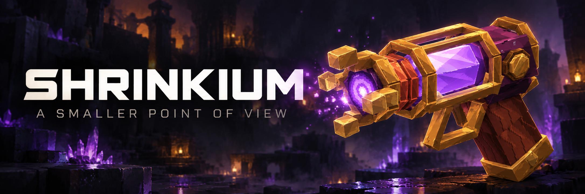
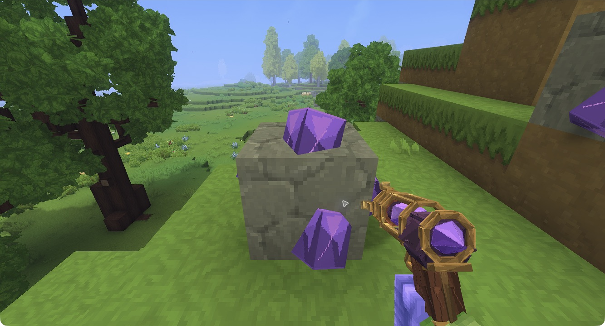
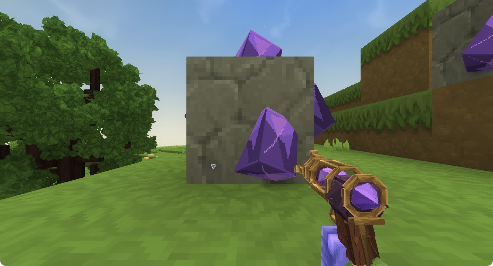

# Shrinkium

Explore Hytale from a smaller point of view with a crystal-powered ray, three target
sizes and a way back to your original size.

**Hytale 0.7 · declared compatibility >=0.7.4 <0.8.0 · single-player playtested**

[Player guide](https://jkswoods.github.io/shrinkium/)
· [Available files](https://github.com/jkswoods/shrinkium/releases)
· [Report an issue](https://github.com/jkswoods/shrinkium/issues)

*Native Hytale 0.7.4 capture. The banner above is promotional artwork.*

## What you can do

- Choose 75%, 50% or 25% of an entity's captured original size.
- Fire at one visible living target within 16 blocks, or use the explicit SELF control.
- Spend one Shrinkium Crystal per successful size change; misses and no-ops are free.
- Use paid ray restoration, or free emergency self recovery with **/shrinkium restore**.
- Keep your original baseline and selected size through normal saving-world reloads.

## Start a small adventure

The implemented acquisition route places Shrinkium Crystal Ore in newly generated
default-world stone caves. Each ore drops two crystals. At **Workbench → Tools**, the
ray recipe takes **6 Iron Bars, 4 Copper Bars and 2 Shrinkium Crystals**, with a
four-second crafting time. The full ordinary survival mining/crafting route remains unverified; keep a world
and player backup. Crystal deposits now cover every ore face.

**Primary** fires the ray. **Secondary** opens its size controls. Choose a size, then
close the panel and aim, or choose **SELF** to apply it to yourself. **RESTORE ORIGINAL**
selects a paid restoration for the next aimed or SELF activation. Move into clear space
before growing. The emergency command restores only yourself and does not need the ray
or crystals.

*Native Hytale 0.7.4: SELF at 25% lowers the viewpoint and spends one crystal.*

## Compatibility and current limits

The manifest declares **>=0.7.4 <0.8.0**. The exact compilation SDK is pinned separately
in release.json; native observations currently cover Hytale **0.7.4**. Future patches
inside the range have not all been tested. Choose a file whose requirements include
your game patch and read its release notes. No downloadable release is promised by
the source branch or guide.

The ray can disappear after free restoration; selecting another hotbar slot and then
the ray recovers it. Single-player gameplay and the corrected ore have been playtested in Hytale.
Real second-client behavior and the full ordinary acquisition route remain unverified.
The ray does not shrink blocks, enlarge beyond original size or rewrite existing caves.
New terrain generation may cause pauses. See the guide's troubleshooting page.

## Build from source

Install **JDK 25** and **Python 3.9+**. Set JAVA_HOME or put the JDK tools on PATH.
Obtain the Hytale SDK legally; it is intentionally absent from the repository.

    python3 tools/test.py
    python3 tools/build.py --server /path/to/HytaleServer.jar
    python3 tools/check_assets.py --assets /path/to/Assets.zip

The build verifies the SDK checksum in release.json, derives the manifest and writes
the JAR to build/libs with its checksum in build/build.json. Manifest compatibility
is a bounded range, independent of that exact SDK pin. Asset regeneration is optional:
install requirements-assets.txt, set HYTALE_ASSETS_ZIP and run tools/assets.py.
Asset/audio validation also requires FFmpeg's ffprobe on PATH.

## Documentation and contributions

The default support branch is **hytale0.7**. The **docs** branch contains the DocMD
version chooser and Hytale-family player guides. Open code PRs against the affected
support branch and documentation PRs against docs; see CONTRIBUTING.md. No open-source
license has been selected. See THIRD_PARTY_NOTICES.md for the asset/dependency notices.
